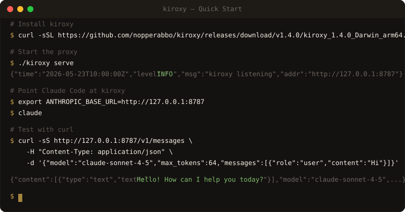
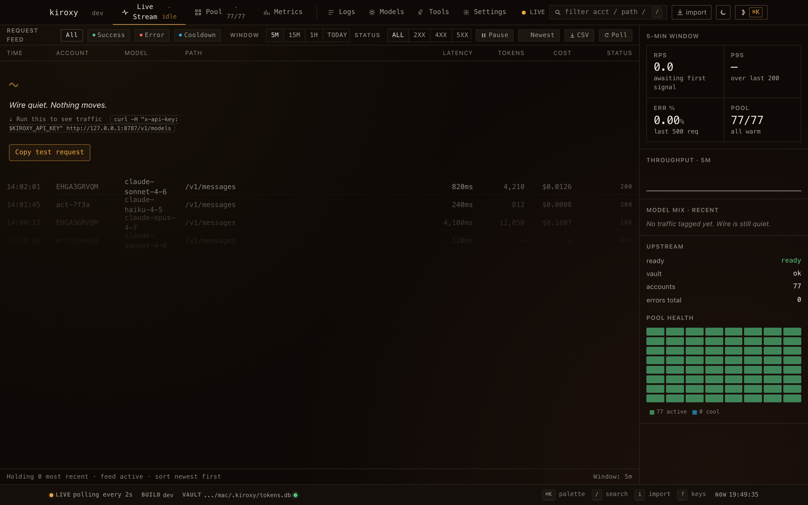
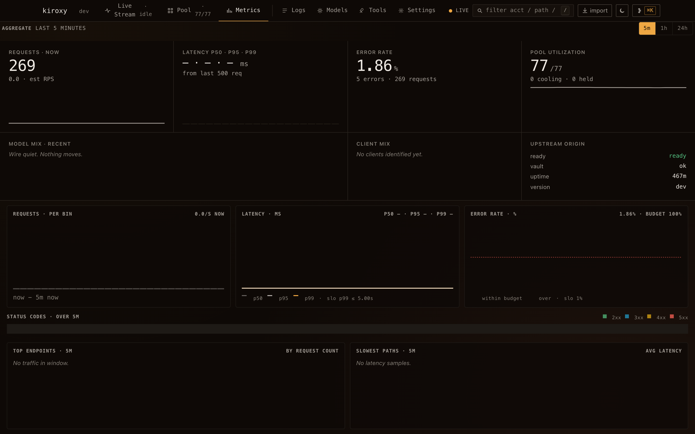
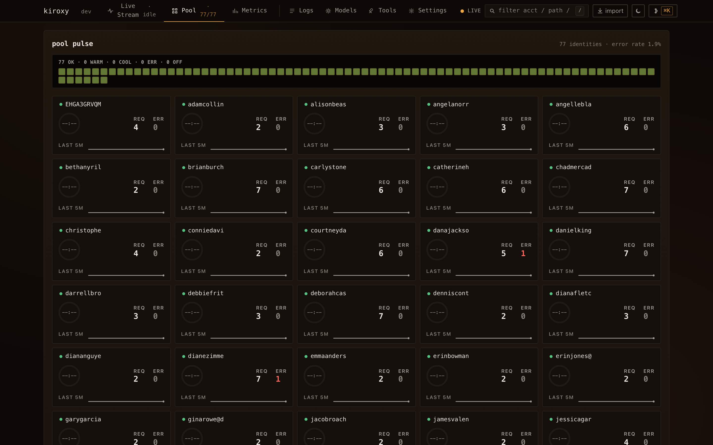
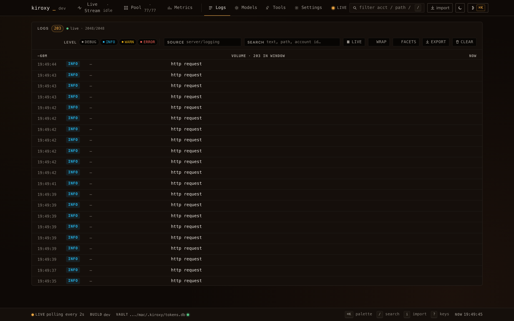
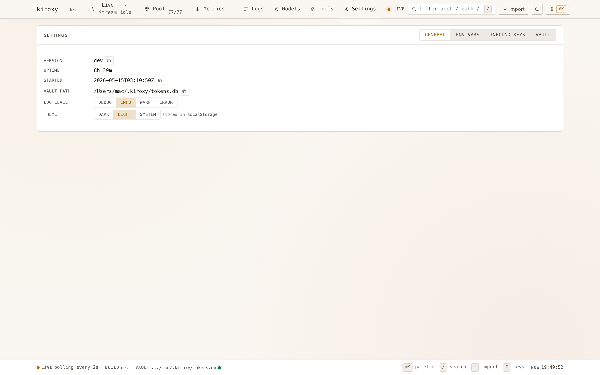
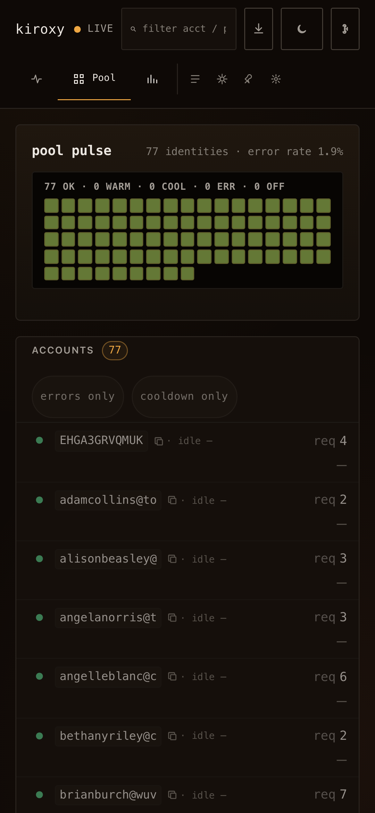

<div align="center">
  <a href="https://github.com/nopperabbo/kiroxy">
    <picture>
      <source media="(prefers-color-scheme: dark)" srcset=".github/assets/banner-dark.svg">
      <source media="(prefers-color-scheme: light)" srcset=".github/assets/banner-light.svg">
      
    </picture>
  </a>

  <br>
  <br>

  <p>
    <a href="https://github.com/nopperabbo/kiroxy/actions/workflows/ci.yml"></a>
    &nbsp;
    <a href="https://github.com/nopperabbo/kiroxy/actions/workflows/codeql.yml"></a>
    &nbsp;
    <a href="https://scorecard.dev/viewer/?uri=github.com/nopperabbo/kiroxy"></a>
    &nbsp;
    <a href="https://codecov.io/gh/nopperabbo/kiroxy"></a>
    &nbsp;
    <a href="https://github.com/nopperabbo/kiroxy/releases/latest"></a>
    &nbsp;
    <a href="https://github.com/nopperabbo/kiroxy/pkgs/container/kiroxy"></a>
  </p>

  <p>
    <a href="#quick-start">Quick Start</a>
    <span>&nbsp;&nbsp;•&nbsp;&nbsp;</span>
    <a href="docs/ARCHITECTURE.md">Architecture</a>
    <span>&nbsp;&nbsp;•&nbsp;&nbsp;</span>
    <a href="docs/TROUBLESHOOTING.md">Troubleshooting</a>
    <span>&nbsp;&nbsp;•&nbsp;&nbsp;</span>
    <a href="https://github.com/nopperabbo/kiroxy/discussions">Discussions</a>
    <span>&nbsp;&nbsp;•&nbsp;&nbsp;</span>
    <a href="CHANGELOG.md">Changelog</a>
  </p>
</div>

<br>

---

## What is kiroxy?

A single-binary, self-hosted proxy that exposes your **Kiro IDE subscription** as a standard **Anthropic Messages API** endpoint. Point Claude Code, Cursor, or any Anthropic-compatible client at kiroxy — it handles credential pooling, token refresh, and request routing transparently.

<div align="center">
  <br>
  
  <br>
  <br>
</div>

<br>

## Why Kiroxy?

| | |
|:---|:---|
| **⚡ Blazing fast** | 23,810 req/s on a single core. Zero-copy SSE streaming. No GC pauses in the hot path. |
| **📦 Single binary** | One `go build`, one file, done. No runtime, no sidecar, no config server. |
| **🏠 Truly self-hosted** | Your credentials never leave your machine. Zero telemetry, zero phone-home. |
| **🔄 Drop-in API** | Standard Anthropic Messages API — existing SDKs and tools work unchanged. |
| **🎯 Does one thing well** | Not a multi-provider gateway. Not a SaaS. A focused proxy that stays out of your way. |

<br>

## How it compares

| | kiroxy | LiteLLM | One-API | OpenRouter |
|:---|:---:|:---:|:---:|:---:|
| Self-hosted | ✅ | ✅ | ✅ | ❌ |
| Single binary | ✅ | ❌ (Python) | ❌ (Node) | — |
| Zero dependencies | ✅ | ❌ | ❌ | — |
| Kiro IDE support | ✅ | ❌ | ❌ | ❌ |
| Multi-account pool | ✅ | ❌ | ✅ | — |
| Operator dashboard | ✅ | ✅ | ✅ | ✅ |
| Memory footprint | ~30 MiB | ~500 MiB | ~200 MiB | — |
| No telemetry | ✅ | ❌ | ❌ | ❌ |

<sub>kiroxy is purpose-built for Kiro IDE credentials. For multi-provider routing (OpenAI + Anthropic + Google), use LiteLLM or OpenRouter instead.</sub>

<br>

## Features

- **🔌 Drop-in compatible** — Standard Anthropic Messages API. Set `ANTHROPIC_BASE_URL` and go.
- **🏊 Multi-account pool** — LRU selection with cooldowns, anomaly detection, and automatic token refresh.
- **📊 Operator dashboard** — 7-view Svelte 5 UI bundled in the binary. Live stream, metrics, logs, pool health.
- **🔒 Zero trust by default** — Distroless container, constant-time auth, vault at mode 0600, no telemetry.
- **⚡ Fast** — 23,810 req/s throughput, ~22 MiB binary, ~30 MiB Docker image.
- **🎨 Beautiful** — Warm charcoal + aged-brass amber design system. Dark + light themes, mobile-responsive.

<br>

## Quick Start

### Install

```bash
# Pre-built binary (Linux/macOS, amd64/arm64)
VERSION=1.4.0 OS_ARCH=Darwin_arm64
curl -sSL "https://github.com/nopperabbo/kiroxy/releases/download/v${VERSION}/kiroxy_${VERSION}_${OS_ARCH}.tar.gz" | tar xz
./kiroxy version
```

```bash
# Or via go install (requires Go 1.26+)
GOEXPERIMENT=jsonv2 go install github.com/nopperabbo/kiroxy/cmd/kiroxy@latest
```

```bash
# Or via Docker
docker pull ghcr.io/nopperabbo/kiroxy:latest
docker run --rm -p 127.0.0.1:8787:8787 -v kiroxy-data:/data ghcr.io/nopperabbo/kiroxy:latest
```

### Configure

```bash
# Option A: Read from kiro-cli database (easiest)
export KIROXY_KIRO_DB_PATH="$HOME/Library/Application Support/kiro-cli/data.sqlite3"

# Option B: Managed vault (multi-account)
./kiroxy import-accounts --file=triplets.txt
```

### Run

```bash
./kiroxy serve
# → kiroxy listening on http://127.0.0.1:8787
```

### Connect

```bash
export ANTHROPIC_BASE_URL=http://127.0.0.1:8787
export ANTHROPIC_AUTH_TOKEN=$(openssl rand -hex 32)
claude  # ← just works
```

<br>

## Dashboard

The bundled **Mansion** dashboard ships in the same binary at `/dashboard-mansion`. Seven views, dark + light themes, mobile-responsive, no external CDN.

<table>
  <tr>
    <td align="center" width="50%">
      <strong>Live Request Stream</strong><br>
      <sub>Real-time SSE feed with drill-down, search, CSV export</sub><br><br>
      
    </td>
    <td align="center" width="50%">
      <strong>Metrics</strong><br>
      <sub>Time-series charts, top-N tables, SLO gauges</sub><br><br>
      
    </td>
  </tr>
  <tr>
    <td align="center" width="50%">
      <strong>Account Pool</strong><br>
      <sub>78-account density viz with anomaly emphasis</sub><br><br>
      
    </td>
    <td align="center" width="50%">
      <strong>Logs</strong><br>
      <sub>Volume histogram, level chips, facets, JSONL export</sub><br><br>
      
    </td>
  </tr>
  <tr>
    <td align="center" width="50%">
      <strong>Light Theme</strong><br>
      <sub>WCAG AA contrast in both schemes</sub><br><br>
      
    </td>
    <td align="center" width="50%">
      <strong>Mobile</strong><br>
      <sub>All 7 views adapt to 390px viewport</sub><br><br>
      
    </td>
  </tr>
</table>

<br>

## Architecture

> Full component-by-component overview: [`docs/ARCHITECTURE.md`](docs/ARCHITECTURE.md)

```
                     KIROXY_API_KEY                                 KIROXY_KIRO_DB_PATH
                          |                                              (or vault)
                          v                                                  |
  Claude Code /-+   +-------------------+   +--------------+   +------+     v
  Cursor         +->|  /v1/messages     |-->| reqconv      |-->| kiro +--> Kiro IDE
  OpenAI SDK     |  |  /v1/messages/    |   | (anthropic → |   |client|   (CodeWhisperer
  your own curl /+  |    count_tokens   |   |  Kiro payload)|  |      |    generateAssistant
                    |                   |   +--------------+   +------+    Response)
                    |  auth MW          |          ^                           |
                    |  log MW (ULID)    |          |                           v
                    |  /healthz         |          |                     +-------------+
                    |  /readyz          |          |                     | respconv    |
                    +----------+--------+          |                     | (Kiro SSE → |
                               |                   |                     |  Anthropic  |
                               v                   |                     |  SSE)       |
                     +----------------+            |                     +----+--------+
                     | pool.TokenGetter|           |                          |
                     | (LRU selection  |           |                          v
                     |  + cooldowns)   |-----------+                    your client
                     +----------+------+                              (streamed chunks)
                                |
                                v
                     +-----------------+
                     | tokenvault      |
                     | (SQLite +       |
                     |  gen-lock OAuth |
                     |  refresh)       |
                     +-----------------+
```

<br>

## Environment Variables

| Variable | Default | Purpose |
|:---|:---|:---|
| `KIROXY_API_KEY` | _(empty = open)_ | Client auth key; empty disables (loopback only) |
| `KIROXY_BIND` | `127.0.0.1` | Bind interface |
| `KIROXY_PORT` | `8787` | TCP port |
| `KIROXY_DB_PATH` | `~/.kiroxy/tokens.db` | Vault SQLite path (mode 0600) |
| `KIROXY_KIRO_DB_PATH` | _(empty)_ | Read creds from kiro-cli DB instead of vault |
| `KIROXY_KIRO_REGION` | `us-east-1` | AWS region for upstream |
| `KIROXY_LOG_LEVEL` | `info` | `debug` / `info` / `warn` / `error` |
| `KIROXY_SHUTDOWN_TIMEOUT` | `30` | Seconds to drain in-flight SSE on SIGTERM |

<br>

## API Endpoints

| Method | Path | Auth | Purpose |
|:---|:---|:---|:---|
| `POST` | `/v1/messages` | ✓ | Anthropic Messages API (streaming + non-streaming) |
| `POST` | `/v1/messages/count_tokens` | ✓ | Token count |
| `GET` | `/healthz` | — | Liveness probe |
| `GET` | `/readyz` | ✓ | Readiness probe |
| `GET` | `/dashboard-mansion` | loopback | Operator dashboard |

Pass API key as `X-Api-Key: <key>` or `Authorization: Bearer <key>`. Every response carries `X-Request-Id`.

<br>

## CLI Reference

```bash
kiroxy serve              # Run the proxy (default)
kiroxy add-account        # Register via AWS Builder ID device-code OAuth
kiroxy import-accounts    # Bulk import from triplet file
kiroxy list-accounts      # Show vault accounts with status
kiroxy remove-account     # Delete an account
kiroxy status             # Pool + request snapshot
kiroxy debug-refresh      # Force token refresh for diagnostics
kiroxy healthcheck        # In-binary health probe (Docker HEALTHCHECK)
kiroxy opencode-config    # Emit opencode.json provider snippet
kiroxy version            # Print version stamp
```

<br>

## Docker

A multi-stage Dockerfile ships with the repo — distroless, nonroot, ~30 MiB.

```bash
# Quick start
cp .env.example .env
make docker-compose-up
curl http://127.0.0.1:8787/healthz

# Or pull from GHCR
docker pull ghcr.io/nopperabbo/kiroxy:latest
docker run --rm \
  -p 127.0.0.1:8787:8787 \
  -v kiroxy-data:/data \
  --read-only --cap-drop=ALL \
  --security-opt=no-new-privileges:true \
  -e KIROXY_API_KEY="your-key" \
  ghcr.io/nopperabbo/kiroxy:latest
```

| Control | Setting |
|:---|:---|
| Base image | `gcr.io/distroless/static-debian12:nonroot` |
| User | `nonroot` (UID 65532) |
| Root FS | Read-only; only `/data` + `/tmp` writable |
| Capabilities | All dropped |
| Privilege escalation | `no-new-privileges:true` |
| Healthcheck | In-binary `kiroxy healthcheck` |

<br>

## Supply Chain Security

Releases are signed with [Sigstore cosign](https://docs.sigstore.dev/) and include SBOM (SPDX format).

```bash
# Verify a release artifact
cosign verify-blob \
  --certificate kiroxy_1.4.0_Darwin_arm64.tar.gz.cert \
  --signature kiroxy_1.4.0_Darwin_arm64.tar.gz.sig \
  --certificate-identity-regexp "github.com/nopperabbo/kiroxy" \
  --certificate-oidc-issuer "https://token.actions.githubusercontent.com" \
  kiroxy_1.4.0_Darwin_arm64.tar.gz
```

<br>

## Troubleshooting

> Full diagnostics playbook: [`docs/TROUBLESHOOTING.md`](docs/TROUBLESHOOTING.md)

| Symptom | Fix |
|:---|:---|
| `401 authentication_error` | No account added. Set `KIROXY_KIRO_DB_PATH` or run `kiroxy add-account` |
| `401 missing_api_key` | Client missing `X-Api-Key` header |
| SSE chunks arrive all at once | Disable proxy buffering (nginx: `proxy_buffering off`) |
| `go build` fails with json/v2 error | Missing `GOEXPERIMENT=jsonv2` — use `make build` |
| AWS suspended account | Keep to 1-3 accounts, reasonable cadence |

<br>

## Contributing

PRs that fix bugs, add tests, or improve docs are welcome. See [`CONTRIBUTING.md`](CONTRIBUTING.md) for guidelines.

```bash
make gate          # fmt + vet + build + test — required before commits
make test-race     # race-mode test run
make lint          # golangci-lint (25+ linters)
```

Commit style: [Conventional Commits](https://www.conventionalcommits.org/) (`feat:`, `fix:`, `docs:`, `ci:`).

<br>

## License

[MIT](LICENSE) — see [`NOTICE`](NOTICE) for attribution of donor projects.

<br>

---

<div align="center">
  <sub>Built with care by <a href="https://github.com/nopperabbo">@nopperabbo</a></sub>
  <br>
  <sub>
    <a href="https://github.com/sponsors/nopperabbo">💛 Sponsor</a>
    &nbsp;&nbsp;•&nbsp;&nbsp;
    <a href="https://github.com/nopperabbo/kiroxy/issues">Report Bug</a>
    &nbsp;&nbsp;•&nbsp;&nbsp;
    <a href="https://github.com/nopperabbo/kiroxy/discussions">Discuss</a>
  </sub>
</div>
